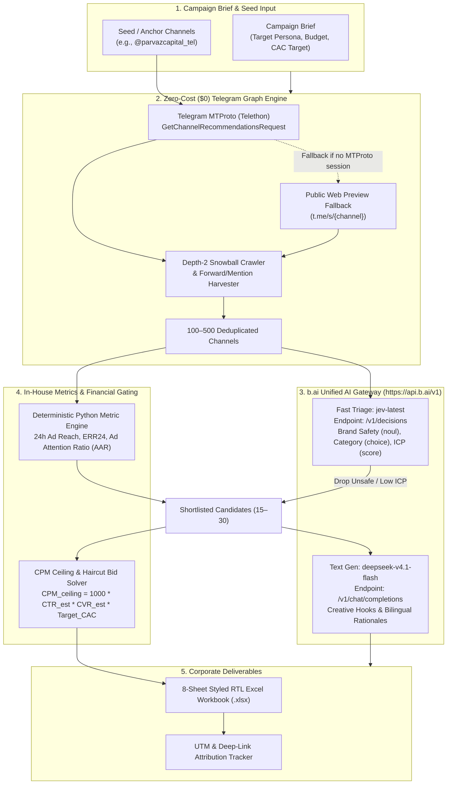

# OmniScout-TG: Media-Planning Decision Intelligence & Attribution Engine
## Master PRD & System Architecture Specification (v3.0 - Recommendation Graph Edition)

---

### 1. Strategic Blueprint & Architectural Pivot

**OmniScout-TG** is an autonomous media-planning intelligence system for Telegram advertising. Unlike traditional keyword-scraping tools or vanity-metric channel rankings that fail to locate influencer-driven and niche channels (e.g., `@AlirezaMehrabi`, `@Halakoei`, `@parvazcapital_tel`), OmniScout-TG operates on a **Telegram-Native Recommendation Graph Traversal** combined with a **Fast AI Decision Pipeline** (`b.ai`).

#### The Core Strategic Pivots (v3.0):
1. **From Keyword Search to Telegram Native Recommendation Graph:**
   - Instead of blind keyword scraping, the discovery engine ingests 1 to 3 curated **"Seed / Anchor Channels"** (e.g., `https://t.me/parvazcapital_tel` or competitor channels).
   - Queries Telegram's native MTProto endpoint `channels.getChannelRecommendations` (`GetChannelRecommendationsRequest`), accessing the exact audience-overlap graph that powers `ads.telegram.org`.
   - Executes recursive **Depth-2 Snowball Expansion** on top high-reach channels and crawls recent post networks (cross-promotions, `forward_from_chat`, `@mentions`) to discover 100 to 500 relevant candidate channels in seconds.
2. **Zero-Cost ($0) Data Harvesting via MTProto & Web Fallback:**
   - Replaces expensive third-party subscriptions (TGStat Plan S, paid market APIs) with direct Telegram MTProto extraction using developer credentials (`api_id`, `api_hash`) via **Telethon**, with automatic public web preview fallback (`https://t.me/s/{channel}`).
   - Harvests member counts, bios, and recent 20–50 posts with exact post-level view counts, forwards, and reactions at zero operational cost.
   - Computes verified advertising metrics (**24h Ad Reach**, **ERR24**, and **Ad Attention Ratio - AAR**) deterministically in Python.
3. **Preserved High-Performance AI Pipeline via `b.ai` Unified Gateway:**
   - **System 1 Semantic Triage (Stage B):** `jev-latest` via `POST https://api.b.ai/v1/decisions` evaluates brand safety (`noul`), category classification (`choice`), and ICP match (`score`) for hundreds of channels concurrently at negligible cost.
   - **Creative Reasoning & Hooks (Stage D):** `deepseek-v4.1-flash` via `POST https://api.b.ai/v1/chat/completions` generates high-conversion creative angles, copy formats, and bilingual (Persian/English) selection rationales.
4. **Deterministic Financial Gating & 8-Sheet Excel Reporting:**
   - Unit-economics CPM ceiling calculation and haircut bidding logic enforced strictly in Python.
   - Generates an executive-ready 8-sheet RTL-compatible Excel workbook (`.xlsx`) with execution contract terms and attribution tracking.

---

### 2. End-to-End System Architecture



---

### 3. API & Data Contracts

#### 3.1 b.ai Gateway Contracts

##### A. Jev Decision Request Contract (`POST https://api.b.ai/v1/decisions`)
Used to screen hundreds of candidates concurrently without consuming text-generation tokens:
```json
{
  "model": "jev-latest",
  "state": {
    "channel_title": "آموزش پایتون و بک‌اند",
    "channel_about": "آموزش گام به گام برنامه‌نویسی پایتون، جنگو و فست‌پی‌آی برای ورود به بازار کار",
    "recent_posts_sample": "پست ۱: نقشه راه بک‌اند در سال ۲۰۲۶... پست ۲: استخدام برنامه‌نویس جونیور...",
    "target_persona": "Junior software developer looking for jobs"
  },
  "questions": {
    "brand_safety": {
      "type": "noul",
      "instructions": "Is this channel clean and free from betting, gambling, warez, crypto pumps, or adult spam?"
    },
    "category": {
      "type": "choice",
      "instructions": "Select the primary category of this channel.",
      "criteria": {
        "tech_programming": "Software, Programming and IT",
        "business_marketing": "Business, Sales and Marketing",
        "general_news": "General News and Politics",
        "entertainment": "Entertainment, Memes and Jokes",
        "other": null
      }
    },
    "icp_alignment": {
      "type": "score",
      "instructions": "Evaluate how well the channel content matches the target persona.",
      "criteria": [
        "Irrelevant",
        "Low Relevance",
        "Moderate Relevance",
        "High Relevance",
        "Direct Match"
      ]
    }
  }
}
```

##### B. DeepSeek Generation Contract (`POST https://api.b.ai/v1/chat/completions`)
Used on shortlisted channels ($\le 30$) to craft persuasive, contextual advertising rationales and creative angles:
```json
{
  "model": "deepseek-v4.1-flash",
  "temperature": 0.2,
  "messages": [
    {
      "role": "system",
      "content": "You are a senior Telegram media planner. Write crisp, high-impact ad rationales backed by metrics."
    },
    {
      "role": "user",
      "content": "Analyze this channel for the Python Bootcamp campaign. Write a 2-sentence rationale in Persian and recommend an ad angle."
    }
  ]
}
```

#### 3.2 Telegram MTProto & Web Fallback Contract

1. **MTProto `GetChannelRecommendationsRequest`**:
   - Takes a seed channel entity (e.g. `@parvazcapital_tel`).
   - Telegram returns up to 100 similar channel entities based on actual user subscription overlap.
2. **Post & Metric Harvesting**:
   - Fetches the last 20–50 posts.
   - Extracts post timestamps, view counts (`views`), forwards, and reactions.
3. **Public Web Preview Scraping (`https://t.me/s/{channel}`)**:
   - Zero-credential fallback that parses channel metadata and recent posts with view counts.

---

### 4. Mathematical Decision Formulations & Metric Calculations

All metrics and financial constraints are calculated deterministically in Python:

#### 4.1 In-House Telegram Metric Formulas
- **24-Hour Ad Reach ($\text{Reach}_{24h}$):** Median view count of posts aged 24h to 72h.
- **Engagement Rate on Reach ($\text{ERR}_{24}$):**
  $$\text{ERR}_{24} = \frac{\text{Avg Reactions}_{24h} + \text{Avg Forwards}_{24h}}{\text{Reach}_{24h}} \times 100$$
- **Ad Attention Ratio ($\text{AAR}$):**
  $$\text{AAR} = \frac{\text{Reach}_{24h}}{\text{Subscribers}}$$

#### 4.2 Allowable CPM Ceiling Formula
$$\text{CPM}_{\text{ceiling}} = 1000 \times \text{CTR}_{\text{est}} \times \text{CVR}_{\text{est}} \times \text{Target CAC}$$

* **$\text{Target CAC}$:** Derived from the client's product price and target contribution margin.
* **$\text{CTR}_{\text{est}}$:** Conservative benchmark ($1.0\%\text{--}2.5\%$), scaled by the channel's Ad Attention Ratio ($\text{AAR}$).
* **$\text{CVR}_{\text{est}}$:** Historical landing-page conversion rate (defaults to conservative $2.0\%$).

#### 4.3 Target Bid with Confidence Haircut
$$\text{Bid}_{\text{target\_cpm}} = \text{CPM}_{\text{ceiling}} \times \left(0.50 + 0.50 \times \frac{C_{\text{data}}}{100}\right) \times (1 - \text{Risk Buffer})$$

* **$C_{\text{data}}$ (Data Confidence Score, 0–100):** Deducts points for short metric history ($-15$), low post volume ($-20$), or unverified audience overlap ($-25$).

---

### 5. Deliverable: 8-Sheet Excel Media Plan (`.xlsx`)

The generated workbook adheres to financial modeling standards with full RTL support for Persian text:
1. **`1. Executive Summary`**: Campaign objectives, allocated budget, projected qualified reach, estimated CAC, and major risk factors.
2. **`2. Recommended Plan`**: The core portfolio of approved channels, verified 24h ad reach, ERR24, target bids, execution contract terms, and bilingual selection rationales.
3. **`3. Test Reserve Cell`**: 15–20% of budget reserved for high-upside, exploratory placements.
4. **`4. Candidate Database`**: Complete log of all 100–500 scanned channels with normalized statistics.
5. **`5. Exclusion Audit Log`**: Full audit trail of disqualified channels with exact rejection codes (`FAILED_JEV_BRAND_SAFETY`, `LOW_ERR24`, `EXCEEDS_CPM_CEILING`).
6. **`6. Creative & Hooks`**: Channel-by-channel editorial style matching, hook angles, and copy directions generated by `deepseek-v4.1-flash`.
7. **`7. Scenario Modeler`**: Dynamic Excel formulas modeling Conservative, Expected, and Aggressive outcome scenarios (Impressions $\to$ Clicks $\to$ Leads $\to$ CAC).
8. **`8. Attribution Tracker`**: Pre-formatted tracking sheet with unique UTM parameters and Telegram deep-link schemas ready for post-campaign reconciliation.

---

### 6. Repository Architecture

```
1002tgmktg/
├── .env.example                     # B_AI_API_KEY, TELEGRAM_API_ID, EMBEDDING_PYTHON_PATH
├── MCP.md                           # Per-client MCP install guide
├── package.json                     # Bun scripts & testing lifecycle
├── pyproject.toml / requirements.txt # Python deps: telethon, pydantic, openpyxl, httpx, fastapi, mcp
├── config/
│   └── settings.py                  # API endpoints, credentials, timeout budgets
├── src/
│   ├── cli.py                       # Rich terminal brief intake & KPI panels
│   ├── mcp_server.py                # MCP stdio server (4 tools)
│   ├── clients/
│   │   ├── bai_client.py            # b.ai client (Jev decisions + DeepSeek completions)
│   │   └── telegram_client.py       # Telethon MTProto wrapper & web preview fallback
│   ├── pipeline/
│   │   ├── graph_discovery.py       # Seed-channel recommendation graph & depth-2 snowball crawler
│   │   ├── validator.py             # Zero-tolerance live validation gate
│   │   ├── hybrid_scorer.py         # BM25 + EmbeddingGemma 2 with reciprocal rank fusion
│   │   ├── embedding_runner.py      # Isolated GPU vectorizer invocation
│   │   └── orchestrator.py          # 6-stage pipeline coordinator
│   ├── models/
│   │   ├── schemas.py               # Pydantic entities (Brief, Channel, Decision, Outcome)
│   │   ├── economics.py             # Deterministic CPM ceiling & bid haircut formulas
│   │   └── payload.py               # JSON payload shared by the GUI and the MCP server
│   ├── reporting/
│   │   └── excel_generator.py       # openpyxl 8-sheet styled workbook engine (with RTL)
│   └── web/
│       ├── app.py                   # FastAPI dashboard: SSE progress, file download
│       └── static/                  # index.html, styles.css, app.js (no build step)
├── scripts/
│   ├── run_plusdesign_campaign.py   # Calibrated PlusDesign campaign runner
│   ├── telegram_auth_wizard.py      # Telethon session login wizard
│   └── verify_seed_expansion.py     # Runnable verification script on @parvazcapital_tel
└── tests/
    ├── test_settings.py             # Configuration tests
    ├── test_models.py               # Pydantic data models validation tests
    ├── test_bai_client.py           # Offline & unit tests for b.ai client
    ├── test_validation_and_scoring.py # Live gate and RRF scoring tests
    ├── test_reporting.py            # Excel workbook tests
    ├── test_pipeline_orchestrator.py# End-to-end pipeline test
    ├── test_auth_wizard.py          # Session wizard tests
    └── test_interfaces.py           # MCP tool registry and web endpoint tests
```

---

### 7. Interfaces: Web GUI and MCP Server

Both interfaces are thin adapters over `OmniScoutPipeline.execute()`. Neither duplicates business
logic; the JSON document they exchange comes from one serializer,
`src/models/payload.py::result_payload()`.

#### 7.1 Web GUI (`src/web/app.py`)

FastAPI application bound to `127.0.0.1:8000`. Static shell plus one ES module, no build step.

| Route | Method | Contract |
| :--- | :--- | :--- |
| `/` | GET | Dashboard shell (`static/index.html`) |
| `/api/config` | GET | Capability report: `bai_live`, `mtproto_enabled`, `environment`, `output_dir`, `defaults`, `preset`. Never returns secret values. |
| `/api/plan` | POST | Accepts a `PlanRequest` (the `CampaignBrief` field set). Responds with `text/event-stream`: repeated `progress` events (`{message, step, total}`), then one terminal `result` (full payload) or `error` (`{message}`) event, plus keep-alive comments during quiet stages. |
| `/api/files/{name}` | GET | Serves a generated `.xlsx` / `.csv`. Resolves to `Path(name).name` inside `OUTPUT_DIR` and returns 404 for anything whose parent escapes that directory. |

The pipeline runs in a daemon thread and hands progress entries to the response generator through a
`queue.Queue`. The generator is synchronous, so Starlette iterates it in its threadpool and the event
loop stays free.

#### 7.2 MCP server (`src/mcp_server.py`)

FastMCP over stdio. Tool names, argument schemas and descriptions are the agent-facing contract.

| Tool | Network | Inputs | Output |
| :--- | :---: | :--- | :--- |
| `estimate_economics` | no | `subscribers`, `reach_24h`, `err24`, `recent_posts_count`, `depth`, campaign economics, optional `quoted_cpm` | CPM ceiling and target bid in USD and TON, confidence score, recommendation, rationale |
| `validate_channels` | yes | `handles: list[str]` | `passed` count plus per-handle `valid`, `reason`, `title`, `subscribers`, `last_post_date`, `caveat` |
| `discover_channels` | yes | `seed_channels`, `target_cluster_size` | Cluster counts and per-channel provenance |
| `run_media_plan` | yes | Campaign brief fields | `campaign`, `summary`, `files`, `channels` |

`estimate_economics` builds a synthetic `ChannelEntity` and calls `calculate_economic_ceiling()`
directly, so its arithmetic matches the pipeline's without a crawl. `run_media_plan` returns absolute
paths under `files` so the host agent can report where the deliverables landed.

#### 7.3 Shared payload shape

`result_payload()` returns `campaign`, `summary`, `files`, `channels`, `creatives`. Channel rows carry
`id`, `title`, `subscribers`, `reach_24h`, `err24`, `aar`, `fit`, `bm25`, `dense`, `cpm_ceiling`,
`bid_target`, `bid_target_ton`, `confidence`, `est_leads`, `recommendation`, `icp_score`,
`validation_status`, `validation_caveat`, `source`, `depth`, `seed_parent`. USD-to-TON conversion uses
the single constant `TON_USD_RATE = 6.6` in the same module.
