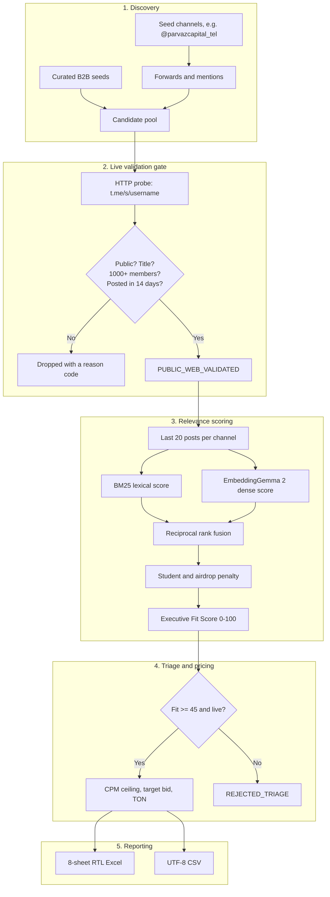

# OmniScout-TG

Media planning and channel pricing for Telegram Ads. Give it a campaign brief and a few seed
channels; it finds real public channels, drops the ones Telegram Ads would reject, scores the rest
against your buyer, and prices each one with a CPM ceiling and a target bid in USD and TON.

Version `0.2.0`. Python 3.11 tested. Windows tested, Linux and macOS expected to work.

## Contents

1. [What it does](#1-what-it-does)
2. [Three ways to run it](#2-three-ways-to-run-it)
3. [Install](#3-install)
4. [Web GUI](#4-web-gui)
5. [MCP server](#5-mcp-server)
6. [CLI reference](#6-cli-reference)
7. [Environment variables](#7-environment-variables)
8. [How a campaign runs](#8-how-a-campaign-runs)
9. [Project structure](#9-project-structure)
10. [Tests and code quality](#10-tests-and-code-quality)
11. [Troubleshooting](#11-troubleshooting)
12. [Roadmap](#12-roadmap)
13. [License](#13-license)

## 1. What it does

Telegram Ads inventory is bought blind. The panel tells you a channel name, a subscriber count and
sometimes a floor bid. It does not tell you whether the channel is real, whether it is alive, whether
your buyer reads it, or what the most you can pay before the campaign loses money.

OmniScout-TG answers those four questions with a fixed pipeline.

- **Discovery** walks out from your seed channels through forwards and mentions, adds a curated set
  of B2B seeds, and probes every candidate.
- **Validation** is a hard gate. The public preview at `https://t.me/s/{username}` must answer HTTP
  200, carry a real title, show at least 1,000 subscribers, and show a post from the last 14 days.
  Anything else is dropped with a logged reason code.
- **Relevance** scores the last 20 posts of each surviving channel with pure-Python BM25 and with
  dense embeddings from `google/embeddinggemma-2`, then fuses the two rankings with reciprocal rank
  fusion. A negative keyword pass pushes student, exam and airdrop channels down.
- **Pricing** is arithmetic, not a guess. `CPM ceiling = 1000 x CTR x CVR x CAC`, then the target bid
  discounts that ceiling by a data-confidence score and a risk haircut.
- **Reporting** writes an 8-sheet RTL Excel workbook and a flat UTF-8 CSV.

Every number in a report traces back to a probe or a formula. There is no synthetic channel data in
the pipeline.

## 2. Three ways to run it

| Interface | Start it with | Built for |
| :--- | :--- | :--- |
| Web GUI | `bun run gui` then open http://127.0.0.1:8000 | Setting up a brief and reading a plan without a terminal |
| MCP server | `python -m src.mcp_server` | Letting Claude Desktop, Cursor, VS Code or DSH run the engine |
| CLI | `bun run cli` | Scripting, CI, and machines without a browser |

All three call the same orchestrator in `src/pipeline/orchestrator.py`.

## 3. Install

Prerequisites: Python 3.10 or newer (3.11.9 is what the project is developed against), and Bun 1.2+
if you want the `bun run` shortcuts. Bun is a convenience; the plain `python -m ...` commands work
without it.

```powershell
bun run install:py          # pip install -r requirements.txt
bun run install:py:dev      # pytest, ruff and the mock helpers
Copy-Item .env.example .env # then edit if you have keys
```

Optional pieces:

- **b.ai key** (`B_AI_API_KEY`): writes creative hooks with a model. Without it, hooks come from
  deterministic templates and nothing else changes.
- **Telegram MTProto session** (`TELEGRAM_API_ID`, `TELEGRAM_API_HASH`): unlocks native channel
  recommendations. Without it, discovery uses the public web graph.
- **EmbeddingGemma 2 venv** (`EMBEDDING_PYTHON_PATH`): the dense half of relevance scoring. Without
  it, BM25 still scores and dense scores fall back to a baseline.

Verify the install:

```powershell
bun run check   # ruff plus the offline test suite
```

## 4. Web GUI

```powershell
bun run gui
```

Opens a local dashboard at http://127.0.0.1:8000. It binds to `127.0.0.1` only, so nothing is exposed
to your network.

What you get:

- **Brief rail** on the left: campaign name, industry, persona, seed channels, budget, allowable CAC,
  and a collapsible conversion model. Values are saved to `localStorage`, so a reload keeps them.
  "Load demo" fills a known-good brief.
- **Live stage rail** while a run is in flight. Six stages report progress as they finish, with a
  timestamped log underneath. Discovery is the slow part and can sit quiet for a minute; the stream
  sends a keep-alive so the connection stays open.
- **Result view**: seven KPIs, a sortable and filterable channel table with a verdict per row (`BUY`,
  `TEST_CELL`, `NEGOTIATE`, `REJECT`, `REJECTED_TRIAGE`), a bid-to-ceiling meter, and a row detail
  panel showing validation status, the operator caveat, discovery depth and estimated leads.
- **Downloads**: one click for the generated `.xlsx` and `.csv`.

The GUI and the CLI can run at the same time. They are separate processes writing to the same
`output/` directory, and the export code renames on a file lock.

The dashboard is plain HTML, CSS and one ES module served by FastAPI. There is no build step and no
frontend toolchain to install.

## 5. MCP server

```powershell
python -m src.mcp_server
```

The server speaks stdio, so you do not run it by hand: your MCP client launches it. Four tools:

| Tool | Purpose |
| :--- | :--- |
| `estimate_economics` | Offline pricing for one channel: ceiling, target bid, verdict |
| `validate_channels` | Live Telegram Ads eligibility gate over a list of handles |
| `discover_channels` | Candidate universe around your seeds |
| `run_media_plan` | Full pipeline plus the Excel and CSV deliverables |

Client configuration for Claude Desktop, Cursor, VS Code and Cline, and DSH lives in
[`MCP.md`](MCP.md), together with parameter details and prompt examples.

## 6. CLI reference

### Interactive campaign brief

```powershell
bun run cli              # python -m src.cli
bun run cli:preset       # --preset: no prompts, demo brief
```

Asks for campaign name, industry, target persona, seed channels, total budget and allowable CAC, then
runs the pipeline and prints the approved portfolio with a KPI summary.

### Calibrated PlusDesign campaign

```powershell
bun run run:plusdesign   # python scripts/run_plusdesign_campaign.py
```

Writes:

- `output/OmniScout_MediaPlan_PlusDesign_Executive_Signature_Round_2.csv`
- `output/OmniScout_MediaPlan_PlusDesign_Executive_Signature_Round_2.xlsx`

### Telegram session wizard

```powershell
bun run auth:telegram    # python scripts/telegram_auth_wizard.py
```

Flags: `--check` (validate the current session only), `--api-id`, `--api-hash`, `--phone`.

## 7. Environment variables

Settings load from the process environment and then from `.env` at the project root, case-insensitively.
`.env` is gitignored. Never commit real values.

| Variable | Purpose | Required | Default |
| :--- | :--- | :---: | :--- |
| `B_AI_API_KEY` | b.ai gateway key for creative hooks | no | unset |
| `B_AI_BASE_URL` | b.ai gateway base URL | no | `https://api.b.ai/v1` |
| `B_AI_JEV_MODEL` | Fast System 1 decision model | no | `jev-latest` |
| `B_AI_DEEPSEEK_MODEL` | Model for creative rationales | no | `deepseek-v4.1-flash` |
| `B_AI_TIMEOUT_SECONDS` | Gateway request timeout | no | `30.0` |
| `B_AI_MAX_RETRIES` | Retries on transient gateway errors | no | `3` |
| `B_AI_RETRY_BACKOFF` | Exponential backoff multiplier | no | `1.5` |
| `TELEGRAM_API_ID` | MTProto app id from my.telegram.org | no | unset |
| `TELEGRAM_API_HASH` | MTProto app hash | no | unset |
| `TELEGRAM_PHONE` | Account phone for the login wizard | no | unset |
| `TELEGRAM_SESSION_NAME` | Telethon session file basename | no | `omniscout_session` |
| `TGSTAT_API_KEY` | TGStat REST token (secondary source) | no | unset |
| `TGSTAT_BASE_URL` | TGStat base URL | no | `https://api.tgstat.ru` |
| `TGSTAT_TIMEOUT_SECONDS` | TGStat timeout | no | `30.0` |
| `TGMARKET_MCP_URL` | TGMarket MCP endpoint | no | `https://tgmarket.io/mcp` |
| `TGMARKET_API_KEY` | TGMarket MCP key | no | unset |
| `TGMARKET_TIMEOUT_SECONDS` | TGMarket timeout | no | `30.0` |
| `EMBEDDING_PYTHON_PATH` | Interpreter of the EmbeddingGemma 2 venv | no | local default path |
| `DEFAULT_TARGET_CAC` | Default allowable CAC (USD) | no | `50.0` |
| `DEFAULT_CVR_EST` | Default landing-page conversion rate | no | `0.02` |
| `DEFAULT_CTR_MIN` | Conservative CTR floor | no | `0.01` |
| `DEFAULT_CTR_MAX` | Optimistic CTR ceiling | no | `0.025` |
| `DEFAULT_RISK_BUFFER` | Haircut applied to the CPM ceiling | no | `0.15` |
| `TEST_RESERVE_PERCENTAGE` | Budget share reserved for test cells | no | `0.20` |
| `PYTHONUTF8` | Force UTF-8 in the Python process on Windows | no | `1` |
| `ENVIRONMENT` | `development`, `testing` or `production` | no | `development` |
| `LOG_LEVEL` | `DEBUG`, `INFO`, `WARNING`, `ERROR`, `CRITICAL` | no | `INFO` |
| `LOG_FORMAT` | `text` or `json` | no | `text` |
| `OUTPUT_DIR` | Where reports are written | no | `output` |

## 8. How a campaign runs



Two details worth knowing before you trust a number.

**The web gate is not the ads panel.** A `PUBLIC_WEB_VALIDATED` row proves the channel exists, is
public, has the members, and is active. Telegram Ads can still refuse it, for example when the owner
turned off monetization. That is why every row carries
`validation_caveat: REQUIRES_MANUAL_CHECK_IN_ADS_PANEL`. Check the handle in the panel's Target
Specific Channels field before you commit budget.

**TON conversion is a constant.** Reports convert USD to TON at 6.6 USD per TON, set once in
`src/models/payload.py`. Change it there when the rate moves enough to matter.

## 9. Project structure

```
1002tgmktg/
├── .env.example                     # Environment template
├── MCP.md                           # Client install guide for the MCP server
├── README.md
├── PRD_AND_SYSTEM_ARCHITECTURE.md   # Full specification and data contracts
├── package.json                     # Bun scripts
├── pyproject.toml                   # Python deps, pytest and ruff config
├── requirements.txt                 # Core plus interface dependencies
├── config/
│   └── settings.py                  # Pydantic settings
├── src/
│   ├── cli.py                       # Rich terminal interface
│   ├── mcp_server.py                # MCP server: 4 tools over stdio
│   ├── clients/
│   │   ├── bai_client.py            # b.ai gateway client
│   │   └── telegram_client.py       # Web preview scraper and Telethon wrapper
│   ├── models/
│   │   ├── schemas.py               # Pydantic entities
│   │   ├── economics.py             # CPM ceiling and bid formulas
│   │   └── payload.py               # JSON payload shared by the GUI and the MCP server
│   ├── pipeline/
│   │   ├── graph_discovery.py       # Seed expansion and candidate crawling
│   │   ├── validator.py             # Zero-tolerance live gate
│   │   ├── hybrid_scorer.py         # BM25 plus dense RRF scoring
│   │   ├── embedding_runner.py      # Runs EmbeddingGemma 2 in its own venv
│   │   └── orchestrator.py          # The 6-stage pipeline
│   ├── reporting/
│   │   └── excel_generator.py       # 8-sheet RTL workbook, lock-safe on Windows
│   └── web/
│       ├── app.py                   # FastAPI app: SSE progress, downloads
│       └── static/                  # index.html, styles.css, app.js
├── scripts/
│   ├── run_plusdesign_campaign.py
│   ├── telegram_auth_wizard.py
│   └── verify_seed_expansion.py
├── tests/
│   ├── test_interfaces.py           # MCP tools and web endpoints
│   ├── test_auth_wizard.py
│   ├── test_bai_client.py
│   ├── test_models.py
│   ├── test_pipeline_orchestrator.py
│   ├── test_reporting.py
│   ├── test_settings.py
│   └── test_validation_and_scoring.py
└── output/                          # Generated reports
```

Where to change things:

| Change | File |
| :--- | :--- |
| Live validation rules | `src/pipeline/validator.py` |
| Executive keywords and negative terms | `src/pipeline/hybrid_scorer.py` |
| Bid and CPM formulas | `src/models/economics.py` |
| Excel layout | `src/reporting/excel_generator.py` |
| Dashboard behaviour | `src/web/static/app.js` |
| MCP tool surface | `src/mcp_server.py` |

## 10. Tests and code quality

```powershell
bun run test        # offline suite: pytest -m "not live"
bun run test:cov    # with coverage
bun run lint        # ruff
bun run lint:fix    # ruff --fix
bun run check       # lint plus tests
bun run test:live   # live b.ai gateway check, needs B_AI_API_KEY
```

The suite is 28 tests. `test_interfaces.py` covers the MCP tool registry, the pricing math against
known values, and the web endpoints including the download path-traversal guard. The pipeline test
runs a real campaign end to end, so it touches the network and takes a couple of minutes.

## 11. Troubleshooting

**`PermissionError: [Errno 13]` when writing the report.** Excel has the file open. The exporter
renames the output with a timestamp (`..._20261106_224500.xlsx`) and keeps going. Close the file to
get the canonical name back.

**A channel is `PUBLIC_WEB_VALIDATED` but the ads panel cannot find it.** The web gate proves the
channel exists and is active. The panel enforces its own rules. Check the handle in the panel before
booking budget; that is what the caveat on every row means.

**The large seed channel eats the whole budget.** A channel with 700k subscribers consumes a small
channel's entire daily budget in minutes when both sit in one campaign. Split it out with its own cap
so the smaller cells get a chance to deliver.

**Dense scores all look identical.** `EMBEDDING_PYTHON_PATH` does not point at a working
EmbeddingGemma 2 venv, so the scorer used the baseline. BM25 still works; set the path for real
semantic ranking.

**The MCP server will not start from a desktop app.** Run `python -m src.mcp_server` from the repo
root in a terminal first. If that works and the app still fails, the app's `PATH` cannot find Python;
give it the absolute interpreter path. Details in [`MCP.md`](MCP.md).

## 12. Roadmap

Done:

- [x] Real candidate discovery with no synthetic data
- [x] Live gate at 1,000 members with an activity check
- [x] Hybrid lexical and dense scoring with RRF
- [x] Negative penalty for student, exam and airdrop audiences
- [x] CPM ceiling and TON bid computation
- [x] 8-sheet RTL Excel and CSV export, lock-safe on Windows
- [x] Local web GUI with live stage progress
- [x] MCP server with four tools and per-client configuration

Next:

- [ ] Session-backed query of `ads.telegram.org` to confirm `PANEL_CONFIRMED` automatically
- [ ] Live floor-bid tracking per topic
- [ ] Telegram bot webhook feeding real conversion rates back into the CAC model

## 13. License

Proprietary and commercial. The orchestrator, the prompt engineering and the report templates belong
to the OmniScout-TG team. See `pyproject.toml` for the license field.
